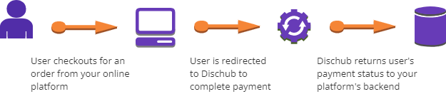

# Dischub PHP Package

A Laravel package for integrating with the [Dischub](https://dischub.co.zw) API.

It supports both official integration types:

- **Redirect integration** - create an order and redirect the customer to Dischub to pay.
- **Non-redirect integration** - keep the customer on your site using EcoCash, InnBucks, Omari or ZimSwitch.

You can use one integration type or both in the same application.

## Installation

```sh
composer require ngoni/dischub-php
```

If you encounter stability issues:

```sh
composer require ngoni/dischub-php:dev-main
```

Publish the configuration file:

```sh
php artisan vendor:publish --provider="Ngoni\DischubPhp\DischubServiceProvider"
```

## Configuration

Static values are configured in `.env`:

```env
DISCHUB_API_KEY=your_api_key_here
DISCHUB_RECIPIENT=your_merchant_email@example.com

DISCHUB_CALLBACK_URL=https://yourdomain.com/dischub/callback
DISCHUB_REDIRECT_URL=https://yourdomain.com/payment/complete
DISCHUB_MODE=test
```

| Variable | Used by | Description |
| --- | --- | --- |
| `DISCHUB_API_KEY` | Both | API key sent in the `X-Api-Key` header. |
| `DISCHUB_RECIPIENT` | Both | Email address used to create your Dischub merchant account. |
| `DISCHUB_CALLBACK_URL` | Redirect, ZimSwitch | HTTPS URL that receives the payment status callback. |
| `DISCHUB_REDIRECT_URL` | Redirect | URL the customer returns to after paying (HTTP or HTTPS). |
| `DISCHUB_MODE` | Redirect | `test` or `live`. |

`DISCHUB_RECIPIENT_EMAIL` and `DISCHUB_NOTIFY_URL` are still accepted for backwards compatibility with older published configs.

The API endpoints can also be overridden with `DISCHUB_ORDERS_URL`, `DISCHUB_PAYMENT_URL`, `DISCHUB_STATUS_URL` and `DISCHUB_ZIMSWITCH_WIDGET_URL`.

## Redirect Integration

Inject `DischubService` and use `redirect()`:

```php
use Illuminate\Http\Request;
use Ngoni\DischubPhp\DischubService;

class OrderController extends Controller
{
    public function store(Request $request, DischubService $dischub)
    {
        $validated = $request->validate([
            'order_id' => 'required|string|max:30',
            'sender' => 'required|string',
            'amount' => 'required|numeric|gt:0|lt:100000',
            'currency' => 'required|in:USD,ZWG',
        ]);

        $response = $dischub->redirect()->createOrder($validated);

        if (($response['status'] ?? null) === 'success') {
            return redirect($dischub->redirect()->getPaymentUrl($validated['order_id']));
        }

        return back()->with('error', $response['message'] ?? 'Unable to create order.');
    }
}
```

The payload sent to Dischub is:

```json
{
  "order_id": "344245663",
  "sender": "+263780070488",
  "recipient": "softwarez@gmail.com",
  "amount": 14.58,
  "currency": "USD",
  "callback_url": "https://yourdomain.com/dischub/callback",
  "redirect_url": "https://yourdomain.com/payment/complete",
  "mode": "test"
}
```

`callback_url`, `redirect_url` and `mode` default to the `.env` values. You may override them per order by including them in the array passed to `createOrder()`.

### Redirect Payment Status

```php
$status = $dischub->redirect()->getPaymentStatus($orderId);

if (($status['status'] ?? null) === 'success') {
    // payment completed
}
```

Possible statuses are `success`, `pending` and `failed`.

## Non-Redirect Integration

Use `nonRedirect()` for payments completed without leaving your platform.

Non-redirect payments do not support test mode. Only ZimSwitch accepts a `callback_url`.

### EcoCash

```php
$response = $dischub->nonRedirect()->ecocash([
    'order_id' => (string) $order->id,
    'sender' => $request->input('sender'),
    'amount' => $order->amount,
    'currency' => 'USD',
    'ecocash_number' => $request->input('sender'),
]);
```

The customer receives a prompt on their EcoCash phone to authorize the payment.

### InnBucks

```php
$response = $dischub->nonRedirect()->innbucks([
    'order_id' => (string) $order->id,
    'sender' => $request->input('sender'),
    'amount' => $order->amount,
    'currency' => 'USD',
]);
```

The response contains `code` and `qrcode` (base64 image). Display the QR code for the customer to scan.

### Omari

```php
$response = $dischub->nonRedirect()->omari([
    'order_id' => (string) $order->id,
    'sender' => $request->input('sender'),
    'amount' => $order->amount,
    'currency' => 'USD',
    'omari_number' => '263780000000',
]);
```

The response contains `omari_otp_reference`. The customer receives an OTP by SMS and enters it in your form. Validate it with:

```php
$status = $dischub->nonRedirect()->validateOmariOtp(
    $orderId,
    $request->input('omari_otp')
);
```

### ZimSwitch

```php
$response = $dischub->nonRedirect()->zimswitch([
    'order_id' => (string) $order->id,
    'sender' => $request->input('sender'),
    'amount' => $order->amount,
    'currency' => 'USD',
]);

$widgetUrl = $dischub->nonRedirect()->getZimswitchWidgetUrl($orderId);
```

Embed the widget in your page:

```html
<iframe
    id="zimswitchFrame"
    src="{{ $widgetUrl }}"
    width="100%"
    height="400"
    frameborder="0">
</iframe>
```

Card details are entered inside the Dischub widget and never touch your server.

### Non-Redirect Payment Status

```php
$status = $dischub->nonRedirect()->getPaymentStatus($orderId);

// Omari status/OTP validation
$status = $dischub->nonRedirect()->getPaymentStatus($orderId, 'omari', [
    'omari_otp' => $request->input('omari_otp'),
]);
```

## Handling Callbacks

`DISCHUB_CALLBACK_URL` receives a POST request when a transaction is processed:

```php
use Illuminate\Http\Request;
use Illuminate\Support\Facades\Log;

class PaymentController extends Controller
{
    public function receiveDischubCallback(Request $request)
    {
        $data = json_decode($request->getContent(), true);

        Log::info('Dischub callback', $data ?? []);

        return response()->json(['message' => 'Callback received successfully']);
    }
}
```

## Backwards Compatibility

The previous `createOrder()` and `getPaymentUrl()` methods still work and delegate to the redirect integration:

```php
$dischub->createOrder($data);
$dischub->getPaymentUrl($orderId);
$dischub->getPaymentStatus($orderId);
```

## License

This package is open-source and available under the [MIT License](LICENSE).
